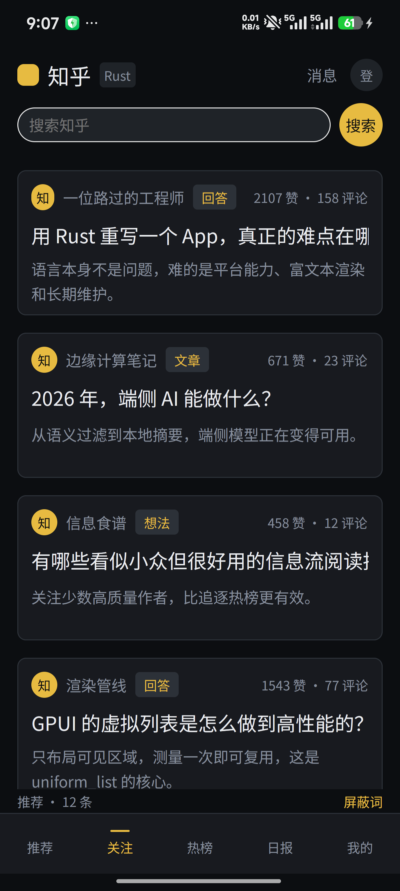
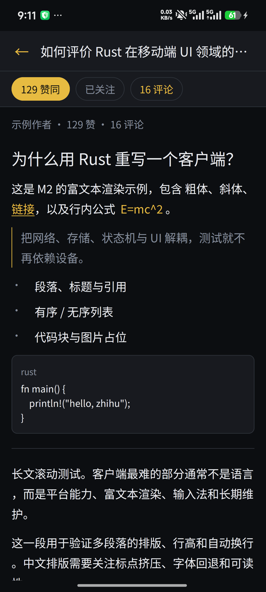
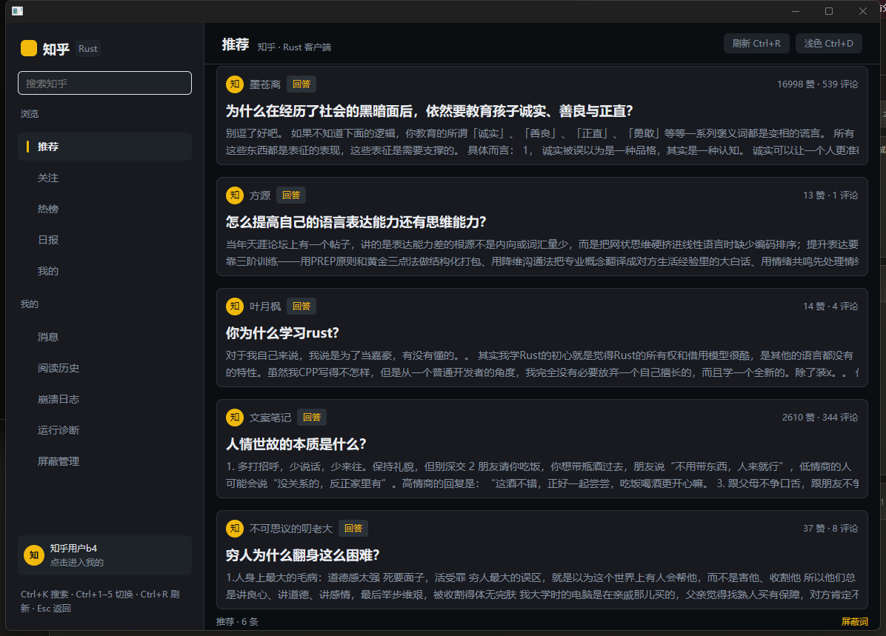
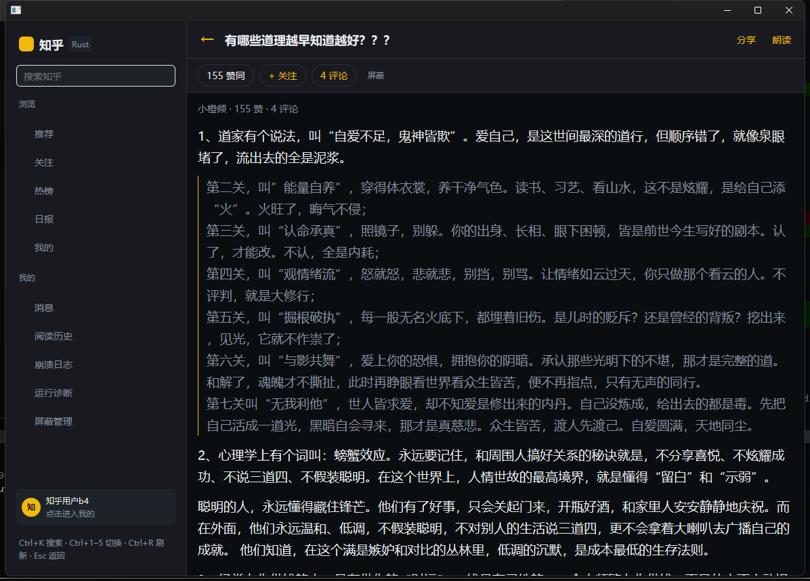
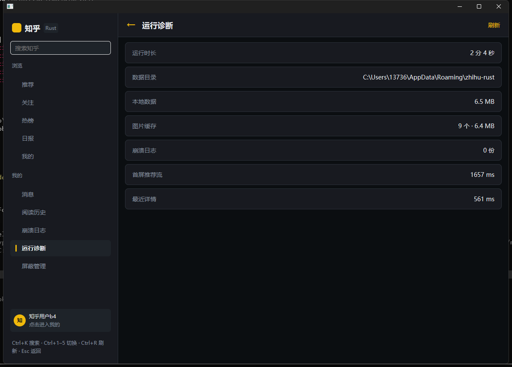
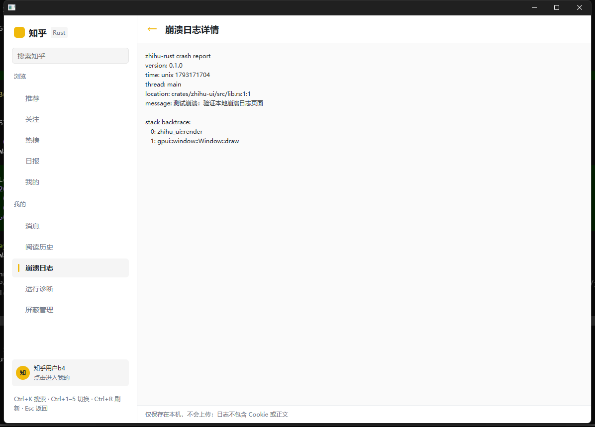

# zhihu-rust

用 Rust + GPUI 重写的知乎客户端（Android 优先，桌面同步）。

参考实现：[zly2006/zhihu-plus-plus](https://github.com/zly2006/zhihu-plus-plus)（Kotlin Multiplatform / Compose）。
本仓库由 [1qingfeng-1/template](https://github.com/1qingfeng-1/template) 初始化。

当前版本：**v1.0.0**（2026-11-02 首个公开版本，Android arm64 与 Windows / Linux 桌面）。

## 状态

**M0 已完成（GO）**：桌面与 Android 真机可运行，中文渲染、虚拟列表、触摸滚动、主题切换、软键盘输入、安全区均已验证。

**M1 已完成**：API 签名、HTTP 客户端、SQLite、Cookie 导入、真实热榜/日报。

**M2 已完成**：HTML → AST 富文本渲染、详情页路由、长文滚动、远程图片加载、返回键导航。

**M3 已完成（2026-10-28 真机验收通过）**：账号校验、点赞/关注、搜索建议、关键词屏蔽、评论、通知中心、Binance 风格主界面（深色 + 黄色强调 + 底部导航）均已验证。

**M4 功能完成（不含写作/草稿/导出）**：评论分页/子评论、完整搜索、用户+话题屏蔽、阅读设置与默认 Tab、图片磁盘缓存、视频播放、TTS、扫码/手机号登录、通知分页、深链与分享均已实现；真机平台门禁待设备接入。

**M5 已完成（2026-10-28）**：桌面自适应双栏与键盘快捷键、本地崩溃报告、运行诊断、发布流水线（签名 + CI + 图标）；M4 真机门禁仍待设备接入。

**M6 进行中（2026-10-29）**：按参考项目补齐想法、收藏、用户内容/关注列表、阅读进度、搜索历史与离线缓存。多账号切换、创作/草稿和文件导出明确不纳入范围。

- 想法真实详情：文本/图片/链接卡片、喜欢、评论、分享、深链与阅读历史。
- 收藏闭环：我的收藏夹、条目分页、收藏/取消收藏、新建收藏夹。
- 用户主页六个 Tab：回答、文章、想法、收藏、关注者、关注，均可继续深入。
- 阅读进度自动保存与恢复；搜索历史可复用和清空。
- 首屏推荐与已打开正文离线缓存，断网时回退并明确提示。
- M6 计划与差距矩阵：[docs/M6_PLAN.md](docs/M6_PLAN.md)

**M7 完成（2026-10-30）**：关注流、话题页、用户互动、评论回复、通知锚点、日报日期分组、正文增强与阅读笔记已落地；Android 统一门禁待检查点。

- 独立关注页：推荐 / 动态双 Tab，独立分页与刷新。
- 话题页：详情、关注、讨论/想法/待回答与排序；话题芯片和深链可进入。
- 用户页：九个 Tab 齐全（含动态、提问、专栏）；服务端拉黑/解拉黑、本地屏蔽推荐、搜索 TA 的创作。提问显示关注/回答数，专栏卡片在浏览器打开。
- 评论：根评论页脚显示“共 N 条回复”，可展开子回复并按回复链缩进；评论作者头像/昵称进入用户页。
- 评论：问题评论、底部固定回复框、根/子回复；自己的评论不显示点赞。
- 通知：回复/点赞通知轮询、未读角标、按 `comment_id` 精确跳转并高亮。
- 详情：完整标题、右上菜单（复制/朗读/分享等）、底部固定赞同/反对/收藏/评论。
- 正文：按住鼠标直接拖选富文本并实时高亮，松开自动复制并弹出笔记工具条；超链接、表情包、首行缩进、名词/动词/形容词克制着色（可关闭）。
- 阅读笔记：选区摘录、颜色、笔记、标签，独立笔记本可打开原文；打开时自动滚动并高亮笔记原文。
- 日报按日期分组并可加载更早日期。
- 评论子回复显示“共 N 条回复”，预览 2 条，可展开/收起，按回复链缩进最多 3 级；根评论优先读取 `comment_v5/root_comment` 以拿到子评论计数，接口返回空页时回退到旧版平铺评论列表。
- 消息页展示邀请/赞同等置顶通知卡片，未读角标与列表一致。
- 正文图片居中显示，查看大图时完整适配窗口。
- M7 计划与进展：[docs/M7_PLAN.md](docs/M7_PLAN.md)

**M8-1 完成（2026-10-30）**：本地推荐候选池与手动采集器（暂不接推荐 UI）。

- SQLite `recommend_pool`（迁移 v5）：按 `(内容类型, 内容 ID)` 去重；重复采集只刷新元数据与过期时间。
- 采集来源白名单：推荐流、关注动态、日报、指定话题、指定用户；不进入搜索/评论/私信，不抓正文与 Cookie。
- 安全策略：默认关闭，需显式开启；每次 1–5 页、请求间隔 1–60 秒、并发 1，任一请求失败（含 401/403/风控）立即停止并保留已采数据；可随时取消。
- 保留策略：默认 7 天、最多 2000 条，超限按采集时间淘汰；屏蔽用户/话题、MCN 开关与屏蔽关键词在入库前过滤。
- 数据全部保存在本机；提供候选池统计与一键清除。
- M8 计划：[docs/M8_PLAN.md](docs/M8_PLAN.md)

**M8-2 完成（2026-10-30）**：本地/混合推荐 Feed 与预设排序（统计特征基线）。

- 预设：均衡 / 专注 / 探索 / 新鲜，固定权重且可复现；探索提高新作者与新鲜内容权重。
- 反馈：打开、读到一半/读完、点赞、关注、收藏、朗读、更多类似/少看这类、不感兴趣；30 天半衰期。
- 本地 Feed 直接由候选池按预设排序；池不足 20 条时回退服务端并标注来源。
- 设置页新增预设选择、采集开关、立即采集/取消、候选池统计与清除。
- 推荐页标题显示当前来源：服务端 / 混合 / 本地推荐；诊断页显示预设与池大小。

**M8-3 完成（ONNX 本地向量）**：

- 内置 `bge-small-zh-v1.5` int8 ONNX 模型（约 24 MB，MIT）与 tokenizer：512 维、CLS 池化、8 条/批；模型说明见 `crates/zhihu-recommend/assets/bge-small-zh-v1.5/MODEL_NOTICE.md`。
- 后台嵌入：推理在 Tokio 阻塞线程池运行，完成后通过事件回填；池变化自动重建，旧模型缓存自动清理。
- 加载失败自动回退 `hash-bigram-v1`，设置页与诊断页显示当前模型和回退状态。
- 嵌入缓存按 `(内容键, 模型版本)` 隔离；清除候选池同时清除嵌入。
- 桌面实测（debug）：60 条候选首次嵌入 1.44 s，UI 不阻塞。
- Android arm64 release 已构建（APK 74.4 MB；关闭 ONNX 为 28.9 MB，增量约 45.5 MB），真机启动与模型加载验证通过；候选池推理需登录后验证。
- 真机构建需随 APK 打包 NDK 的 `libc++_shared.so`（见 `docs/RELEASE.md`）。

- 桌面宽窗口（≥900px）左侧栏 + 右侧内容；`Ctrl+K` 搜索、`Ctrl+1..5` 切 Tab、
  `Ctrl+R` 刷新、`Ctrl+D` 主题、`Esc` 返回。
- 本地崩溃日志（不包含 Cookie/正文、不上传）与运行诊断页。
- 可选本地推荐：关闭/混合/本地三种排序，主题/作者/标题特征，默认关闭、纯本机。
- 富文本排版：标准 / 宽松 / 紧凑三套预设，统一栏宽、行高、引用、代码与图片样式。
- 推荐流双列瀑布流、无限滚动、任意位置下拉刷新；条目右滑可“不感兴趣/屏蔽作者/屏蔽话题”。
- 详情页显示作者与发布/编辑时间，支持赞同/反对；评论支持默认/最新/最早/最多赞同排序。
- 用户头像与用户主页（资料、关注/粉丝、回答列表、关注/取关），从 Feed/详情/评论/通知进入。
- 评论支持赞同/反对/喜欢（带图标）、盖楼缩进与回复颜色标签、0 回复隐藏入口；回答与评论可复制 Markdown。
- TTS 设置（语速/音调/音量/音色）与歌词式同步高亮朗读：当前句黄色、自动滚动、点击跳读、底部播放条。
- 详情的富文本可直接按住拖选并实时高亮，松开左键自动复制并弹出笔记工具条；代码块/公式块一键复制。
- 问题页查看全部回答（默认/最新/最多赞同）；日报在应用内阅读。
- 侧栏整体可折叠为图标栏，“浏览/我的”分组也可单独折叠。
- 评论返回正文消失的问题已修复。

- 重写规划：[docs/REWRITE_PLAN.md](docs/REWRITE_PLAN.md)
- M0 报告：[docs/M0_REPORT.md](docs/M0_REPORT.md)
- M1 报告：[docs/M1_REPORT.md](docs/M1_REPORT.md)
- M2 报告：[docs/M2_REPORT.md](docs/M2_REPORT.md)
- M3 报告：[docs/M3_REPORT.md](docs/M3_REPORT.md)
- M4 计划：[docs/M4_PLAN.md](docs/M4_PLAN.md)
- M4 进展：[docs/M4_REPORT.md](docs/M4_REPORT.md)
- M5 计划：[docs/M5_PLAN.md](docs/M5_PLAN.md)
- M5 进展：[docs/M5_REPORT.md](docs/M5_REPORT.md)
- M6 计划与进展：[docs/M6_PLAN.md](docs/M6_PLAN.md)
- M7 计划（关注流 / 话题 / 搜索 / 阅读）：[docs/M7_PLAN.md](docs/M7_PLAN.md)
- M8 计划（后台采集 / 本地向量推荐）：[docs/M8_PLAN.md](docs/M8_PLAN.md)
- P2 评估（本地推荐 / NLP）：[docs/M5_P2_EVALUATION.md](docs/M5_P2_EVALUATION.md)
- 发布与签名：[docs/RELEASE.md](docs/RELEASE.md)

| Binance 风格主页 | 点赞 / 关注 / 评论 |
| --- | --- |
|  |  |

> M4 新增：视频播放、TTS 朗读、手机/扫码登录（含风控引导）、图片磁盘缓存与全屏查看、
> 阅读历史、深链分享、Capture 阶段滑动切 Tab。
> 详见 [docs/M4_REPORT.md](docs/M4_REPORT.md)。

| 桌面双栏 | 评论返回后正文保留 |
| --- | --- |
|  |  |

| 运行诊断 | 本地崩溃日志 |
| --- | --- |
|  |  |

> M5 新增：桌面双栏与快捷键、本地崩溃报告、运行诊断、发布流水线与应用图标、
> 富文本排版三套预设（标准/宽松/紧凑）。
> 详见 [docs/M5_REPORT.md](docs/M5_REPORT.md)。

## 技术栈（已验证组合）

| 组件 | 版本 |
| --- | --- |
| Rust | 1.85+ |
| `gpui`（`gpui-pre`） | `=0.3.6` |
| `gpui-kit` | 0.6.5（`vendor/gpui-kit`，上游 `13c716b`） |
| `gpui-mobile` | 0.1.0（`vendor/gpui-mobile`，上游 `5fd54f4`） |
| `ratex-gpui` | 0.4.1（独立公式排版，KaTeX 解析器移植） |
| Gradle / AGP / JDK | 9.4.1 / 9.1.0 / 21 |

> `gpui-kit` 最新 0.8.x 依赖 `gpui-pre =0.3.10`，与 `gpui-mobile` 的 `=0.3.6` 冲突。升级必须两边一起回归。
> 依赖获取说明见 [vendor/README.md](vendor/README.md)。

## 目录

```text
crates/zhihu-types   领域类型
crates/zhihu-api     HTTP / 签名 / 认证（M1）
crates/zhihu-content HTML → AST / Markdown / 公式（M1）
crates/zhihu-store   SQLite / 缓存 / 屏蔽词（M1）
crates/zhihu-core    无 UI 的服务层与状态
crates/zhihu-ui      GPUI 页面与组件
crates/zhihu-platform 平台能力抽象
apps/desktop         桌面入口
apps/mobile          Android / iOS 入口
android/             Gradle APK 宿主
vendor/              固定版本的上游源码快照
```

## 开发

```bash
cargo check
cargo test
cargo run -p zhihu-desktop
```

### Windows PC 版

```bash
cargo build --release -p zhihu-desktop
```

产物：`target/release/zhihu-desktop.exe`（单文件，无需安装）。
数据目录：`%APPDATA%\zhihu-rust`；可用 `ZHIHU_DATA_DIR` 覆盖。
本仓库同时提供打包好的目录与 zip：

- `dist/zhihu-desktop-windows-x64/zhihu-desktop.exe`
- `dist/zhihu-desktop-windows-x64.zip`

使用说明见包内 `README.txt`。桌面宽窗口自动切换双栏；快捷键见包内说明。

### Android

前置：Rust `aarch64-linux-android` target、`cargo-ndk`、Android SDK 36、NDK 28、JDK 17+。

```bash
export ANDROID_HOME="C:/Users/13736/AppData/Local/Android/Sdk"
export ANDROID_NDK_HOME="$ANDROID_HOME/ndk/28.2.13676358"
export JAVA_HOME="C:/Program Files/AndroidStudio/jbr"

# 1. 交叉编译
cargo ndk -t arm64-v8a -P 26 -o android/app/src/main/jniLibs build -p zhihu-mobile

# 2. 去符号 + 删除依赖 crate 的副产物
"$ANDROID_NDK_HOME/toolchains/llvm/prebuilt/windows-x86_64/bin/llvm-strip.exe" \
  --strip-all android/app/src/main/jniLibs/arm64-v8a/libzhihu_mobile.so
rm -f android/app/src/main/jniLibs/arm64-v8a/libgpui_mobile.so

# 3. 打包安装
(cd android && cmd //c ".\\gradlew.bat assembleDebug --no-daemon")
adb install -r android/app/build/outputs/apk/debug/app-debug.apk
adb shell am start -n dev.zhihurs.app/dev.gpui.mobile.GpuiActivity
```

> `-P 26` 必须与 `minSdk 26` 一致：NDK 只在 API 26+ 的 sysroot 中提供 `libnativewindow.so`。
> Gradle 使用阿里云 Maven 镜像与腾讯 Gradle 镜像（`android/settings.gradle.kts`、`gradle-wrapper.properties`）。

## Android 交互

- 底部导航：图标 + 文字，选中项整体变黄；导航栏与内容之间有一条全宽细分割线。
- 左右滑动切换 tab：内容跟随手指实时位移，顶部搜索行与底部导航保持固定；超过 30% 宽度松手才切换（220 ms 缓动），不足则回弹。关注页的“推荐/动态”子 tab 优先响应滑动，子 tab 栏本身固定。
- 页面路由：进入详情、评论、搜索等页面从右侧滑入，返回时下层页面轻微回位并淡入（240 ms）。
- 我的页面：账号卡片固定在顶部；“账号与登录 / 我的内容 / 推荐设置 / 阅读与外观 / 其他工具”五组默认折叠，点击组头展开。登录按钮进入独立的全屏登录页（手机号 / 扫码 / 浏览器导入）。
- 冷启动：全屏铺满的画报（Bing 每日图 + 一言），顶部与底部为渐变遮罩而非硬黑边；首帧起停留 5 秒再淡出进入首页，右上角「跳过 N」逐秒倒计时，点击立即以同样的 200 ms 淡出。本地维护 5 张画报的缓存池，按「最久未看」轮换，展示后后台补新；无缓存时使用内置名言。
- 登录：独立登录页支持手机号验证码、扫码与「浏览器登录（自动导入）」；后者在内置 WebView 完成登录，按移动端 UA 渲染，标题栏与底部按钮避开系统栏。
- 推荐/关注时间线：每条内容的相对时间（刚刚 / N 小时前 / 昨天 / N 天前）放在条目内的「赞 · 评论 · 时间」一行，不另占左侧栏。下拉刷新把最新内容排到时间线最前端，上拉继续加载更早的历史条目。
- 已读状态：打开内容停留 1 秒后标记已读并写入本地阅读历史；已读条目标题变灰，未读保持高对比。
- 详情页顶部标题栏固定 56 px 高，长标题单行省略，不会被撑开。
- 评论缓存：进入过的评论页在内存中保留（最近 12 篇，含分页位置），返回再进秒开且不会重复请求；下拉刷新或加载失败重试才重新拉取，已展开的子回复保持打开。
- 正文缓存：本次运行中打开过的回答 / 文章 / 想法保留在内存里（最近 8 篇）。返回后再次进入直接显示正文并恢复阅读位置，不再经过加载态、也不重复请求；下拉刷新或点重试会重新拉取并替换缓存。
- 状态栏：系统状态栏文字与图标跟随主题切换——亮色页面使用深色图标，暗色主题、闪屏画报与全屏看图保持浅色图标（应用为沉浸式绘制，状态栏没有自己的底色）。
- 朗读：使用系统文字转语音引擎（`TextToSpeech`）。manifest 声明了 `TTS_SERVICE` 查询可见性（Android 11+ 必需，否则引擎初始化直接失败）；引擎不接受 `zh_CN` 时依次回退到 `zh` 语言和第一个中文音色；引擎不可用或没有中文语音时弹出提示并停止播放，不再出现“高亮在走但没有声音”。
- 音量键：NativeActivity 会把按键直接送给原生输入队列，Java 的 `dispatchKeyEvent` 收不到；因此在 native 层拦截 `KEYCODE_VOLUME_UP/DOWN/MUTE`，调用 `AudioManager.adjustStreamVolume(STREAM_MUSIC, …, FLAG_SHOW_UI)` 调节媒体音量并弹出系统音量面板，事件不再透传给 Rust。
- 评论正文中的 `[图片]` 会渲染为缩略图（96 px 方图，点击可看大图），与文字同列混排。
- 热榜条目：列表为普通滚动列（热榜接口所有词条共用一个 `query_id`，元素 id 需自行加序号，否则只有首行可点击）；点击后解析为问题并进入详情，解析失败退回搜索结果页。
- 图片预览支持双指缩放（Android 双指手势映射为 `PinchEvent`），缩放以双指中心为锚点、放大后可单指平移、缩回 1x 自动居中；双击以中心缩放。详情页下拉刷新、触底自动加载更多与桌面版一致。
- 评论列表在移动端左右贴边，与推荐卡片一致。


AGPL-3.0。参考项目的 API 常量、签名实现与测试语料移植后仍受其 AGPL 许可约束。
“知乎”为第三方商标，本项目与知乎官方无关。
