# M5 进展报告

> 日期：2026-10-28
> 范围：差异化与发布（`docs/M5_PLAN.md`）。
> 状态：桌面端双栏/快捷键、本地崩溃报告、运行诊断、发布流水线与图标已完成；
> M4 真机门禁仍待设备接入；本地推荐 / NLP 过滤保留为 P2 评估。

---

## 1. 已完成

### 1.1 桌面自适应双栏（任务 #23）

- 宽窗口（≥ 900px，桌面平台）切换为**左侧导航栏 + 右侧内容区**：
  - 侧栏：品牌、搜索框、推荐/关注/热榜/日报/我的、消息、阅读历史、
    崩溃日志、运行诊断、屏蔽管理、登录态、主题与快捷键提示。
  - 内容区：页标题、刷新/主题按钮、当前 Tab 内容与状态栏。
- 详情、搜索、评论、通知、历史、崩溃日志、诊断等路由页同样在侧栏壳内渲染，
  不再退回单栏。
- 窗口小于 900px 时自动回到原有移动端单栏布局；Android/iOS 始终使用单栏，
  避免影响已验收的触摸交互。
- 桌面默认窗口从 430×900 调整为 1180×820，最小 720×520。
- 桌面点击视频卡片改为交给系统浏览器/播放器打开，不再显示“内嵌视频”空页。
- 侧栏切换 Tab 会先清空路由栈，避免“在详情页点侧栏后返回出现空页面”。

### 1.2 键盘快捷键（任务 #24）

| 快捷键 | 行为 |
| --- | --- |
| `Ctrl/Cmd + K` 或 `Ctrl/Cmd + F` | 聚焦搜索框 |
| `Ctrl/Cmd + 1..5` | 推荐/关注/热榜/日报/我的 |
| `Ctrl/Cmd + R` | 刷新当前 Tab 或路由页 |
| `Ctrl/Cmd + D` | 深色/浅色切换（持久化） |
| `Esc` | 关闭图片/视频/崩溃详情，或返回上一页 |
| `Alt + ←` | 返回上一页 |

- 快捷键统一走 `handle_shortcut`，桌面宽窄布局与路由页共用。
- 刷新会按当前状态分发：推荐流、热榜、日报、搜索、评论、通知、历史、
  崩溃日志、诊断、详情。
- 无障碍：侧栏、底部导航与 Feed 卡片提供 `aria_label` / `aria_selected`，
  可点击区域保持 ≥38px；GPUI 的完整无障碍树支持仍有限，作为后续 P2 改进。

### 1.3 本地崩溃报告（任务 #25）

- panic hook 写入 `data_dir/crashes/crash-<unix>-<pid>.log`：
  版本、时间、线程、位置、panic 消息与 backtrace。
- 只记录 panic 元数据，不包含 Cookie、请求体或正文；不上传。
- 保留最近 20 份，自动清理旧文件；单文件查看上限 256 KiB。
- “我的 → 崩溃日志”支持列表、详情、刷新、清空；
  桌面侧栏同入口。
- 桌面入口与 Android/iOS 入口均安装 hook（Android 与 logcat hook 链式共存）。

### 1.4 运行诊断（任务 #27）

- “我的 → 运行诊断”展示：
  - 运行时长、数据目录、本地数据总量；
  - 图片缓存文件数与体积；
  - 崩溃日志数量；
  - 首屏推荐流耗时（从启动到 Feed 事件）；
  - 最近一次详情加载耗时。
- 数据按需扫描，不参与每帧渲染。

### 1.5 发布流水线与签名（任务 #26）

- Android `build.gradle.kts`：
  - 环境变量或 `android/keystore.properties` 读取 release 签名；
  - 缺失签名时回退 debug key（仅冒烟测试）；
  - `ZHIHU_VERSION` / `ZHIHU_VERSION_CODE` 由 CI tag 注入。
- `.github/workflows/release.yml`：tag 触发
  - `cargo ndk` 构建 `arm64-v8a` → `assembleRelease` → APK；
  - Windows/Linux 桌面 release 包；
  - `git-cliff` changelog + GitHub Release。
- `.gitignore` 排除 keystore/properties；密钥只放 Secrets。
- 新增应用图标：深色底 + 黄色“知”，覆盖 mdpi–xxxhdpi 与圆形图标，
  并提供 Android 8+ 自适应图标（前景/背景分层）。
- 详细步骤见 `docs/RELEASE.md`。

### 1.6 缺陷修复：评论返回后正文消失
- 现象（用户反馈）：推荐 → 回答 → 评论 → 返回，回答显示
  “内容不可用，请返回重试”。
- 原因：`back()` 弹出评论路由时无条件清空 `detail` / `detail_blocks`，
  而回答路由仍在栈中，渲染时没有内容。
- 修复：新增 `sync_detail_with_route()`：
  - 返回后的栈顶仍是同一回答/文章时**保留已加载正文**；
  - 栈顶是不同内容时清空并重新加载；
  - 栈顶非内容页时正常清理。
- 新增 `content_route_target` 单测，覆盖回答、文章与评论/通知路由。
- PC 实测：回答 → 评论 → 返回，正文与点赞/关注/评论状态保持正常。

### 1.7 可选本地推荐（P2 最小实现）

- 新 crate `zhihu-recommend`（纯 Rust、无模型）：
  - `关闭 / 混合 / 本地` 三种排序模式，默认关闭；
  - 30 天半衰期的主题/作者权重；
  - 主题 + 标题字符二元组（过滤功能字与停用词）特征；
  - 质量、新鲜度、作者亲和度加权；
  - 贪心多样性：同作者连续第 3 条强惩罚，同主题重叠降权；
  - 空画像或关闭时保持服务端顺序。
- SQLite `recommend_feedback`（迁移 v2，最多 2000 行）：
  - 只存作者 id、主题/标题特征、权重、时间；
  - 不存标题原文、正文或 Cookie；`item_id + action` 去重。
- UI：“我的 → 推荐排序”切换模式并持久化；“推荐数据 N 条 / 清除”；
  仅在模式开启时记录打开/点赞/关注；运行诊断显示模式与反馈条数。
- 隐私：关闭模式时不采集；数据全在本机，可一键清除。

### 1.8 Windows PC 发布包

- `cargo build --release -p zhihu-desktop` 成功，单文件 exe 约 15.41 MB
  （`+crt-static`，不依赖 VCRUNTIME140.dll）。
- 交付目录与压缩包（已 gitignore，仅本地产物）：
  - `dist/zhihu-desktop-windows-x64/zhihu-desktop.exe`
  - `dist/zhihu-desktop-windows-x64/README.txt`（运行、登录、数据目录、快捷键、隐私）
  - `dist/zhihu-desktop-windows-x64/LICENSE`（AGPL-3.0）
  - `dist/zhihu-desktop-windows-x64.zip`（约 6.9 MB）
- SHA256：
  - zip `aa883594df7ba1a2e2e9b4402927e313077fda12f3880e1d4b41ecfc420f331e`
  - exe `c69d2491991eb9921e85d8aa16dcd5de1d3380163d0e17eaf5181bfcd033500d`
- 窗口标题与任务栏图标：`知乎 Rust` + 深底黄色“知”图标（`embed-resource` 嵌入 exe）。
- 桌面点击视频卡片改为在系统浏览器/播放器打开。
- 包内已包含 1.9 的富文本排版预设与实时预览。
- 包内包含 1.11–1.13 的反馈修复：双列瀑布流、任意位置下拉刷新、无限加载、
  卡片右滑操作、评论排序/赞同/反对/喜欢、侧栏折叠、赞同/反对与时间显示、
  用户主页与头像、问题页、日报应用内阅读、Markdown 复制、选择复制、TTS 设置与同步朗读。
- 已在 release exe 上验收：登录态推荐流、双栏、排版预设、标题栏/图标、推荐排序默认关闭。


### 1.9 富文本排版优化

- 新增 `zhihu-ui/src/typography.rs`：统一正文、标题、引用、列表、代码、图片
  caption、分割线的字号/行高/留白/圆角；复用 GPUI 文本整形与 `ratex-gpui`
  公式排版，不引入新的重型排版引擎。
- 阅读栏宽：详情正文最大 760px / 700px / 820px，桌面自动居中；移动端窄屏满宽。
- 三套预设（“我的 → 排版”，默认标准）：
  - **标准**：16px / 28px 行高，760px 栏宽；
  - **宽松**：18px / 34px，700px 栏宽，更大块间距；
  - **紧凑**：15px / 23px，820px 栏宽，更密集。
  - 手动调整字号/行距会切换为“自定义”，旧版本自定义设置自动识别为 custom。
- 视觉细节：标题比例与上下留白、引用左侧 3px 强调线与浅底、列表缩进、
  代码块等宽字体/圆角/横向滚动、行内代码底色、图片圆角与居中 caption、
  浅色主题 surface 修正（详情/搜索/评论/通知）。
- 设置页提供实时排版预览卡片。
- 持久化：`AppSettings.typography`（SQLite `typography` 键）。
- 测试：新增预设映射、三套 scale/spacing、Custom 保留手动字号/行距。
- PC 截图：`docs/m5-typo-standard.png` / `m5-typo-relaxed.png` /
  `m5-typo-compact.png` / `m5-typo-profile.png`。

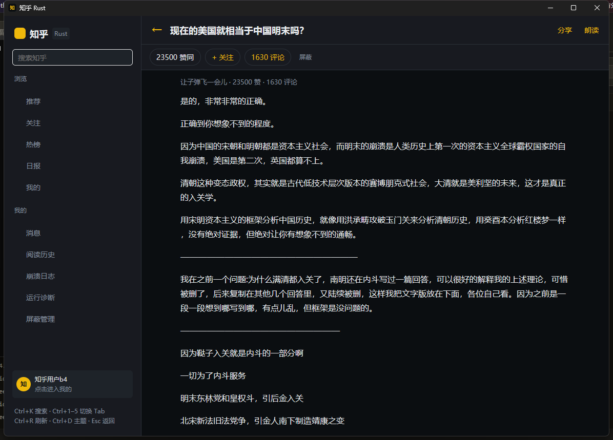

### 1.10 P2 评估

- 输出 `docs/M5_P2_EVALUATION.md`：
  - 本地推荐已按评估落地最小版本；
  - NLP 语义屏蔽需要 10–30 MB 包体与移动端推理，且缺少标注数据，暂缓；
  - AIGC 标记/投票依赖服务端，不做客户端伪造。

### 1.11 PC 体验反馈修复

- **详情页信息去重**：作者行改为“作者 · 发布于/编辑于 YYYY-MM-DD”，
  赞同/评论只在操作栏出现一次；文章/回答详情新增 `created_time`/`updated_time` 解析。
- **反对**：操作栏新增“反对”，与赞同互斥、可取消；回答走 `type=down/neutral`，
  文章走 `voting=-1/0/1`，赞同数只随赞同状态变化。
- **空白噪声清理**：HTML 清洗阶段去掉 `&nbsp;`/纯 `<br>` 空段落，
  3 个以上连续 `<br>` 转为分隔线，连续分隔线合并；普通段落的最多两个换行保留。
- **双列瀑布流**：宽窗口两列按预估高度分配卡片，窄窗口单列；卡片可自适应高度。
- **无限滚动**：推荐流按 `page_number` 分页（每页 6 条），解析 `paging.is_end`；
  滚动接近底部/双列未填满时自动加载，底部也可点击加载；到达末页显示“没有更多了”。
- **任意位置下拉刷新**：条目区域任意位置向下拖动 ≥50px 触发刷新；
  主要水平拖动仍进入卡片操作，二者由方向阈值仲裁。
- **卡片向右拖动**：显示“不感兴趣 / 屏蔽作者 / 屏蔽话题”；
  不感兴趣会本地过滤并写入负向推荐反馈，屏蔽作者/话题复用现有屏蔽表。
- **侧栏折叠**：顶部 `«/»` 可把整个侧栏收成 72px 图标栏（保留 5 个 Tab、
  消息/历史/崩溃/诊断/屏蔽与账号头像）；展开后“浏览 / 我的”两组还可分别折叠。
- **评论排序**：根评论与子回复支持“默认 / 最新 / 最早 / 最多赞同”，
  排序在本地进行，不改变服务端分页状态。

| 双列瀑布流 | 右滑操作 |
| --- | --- |
| 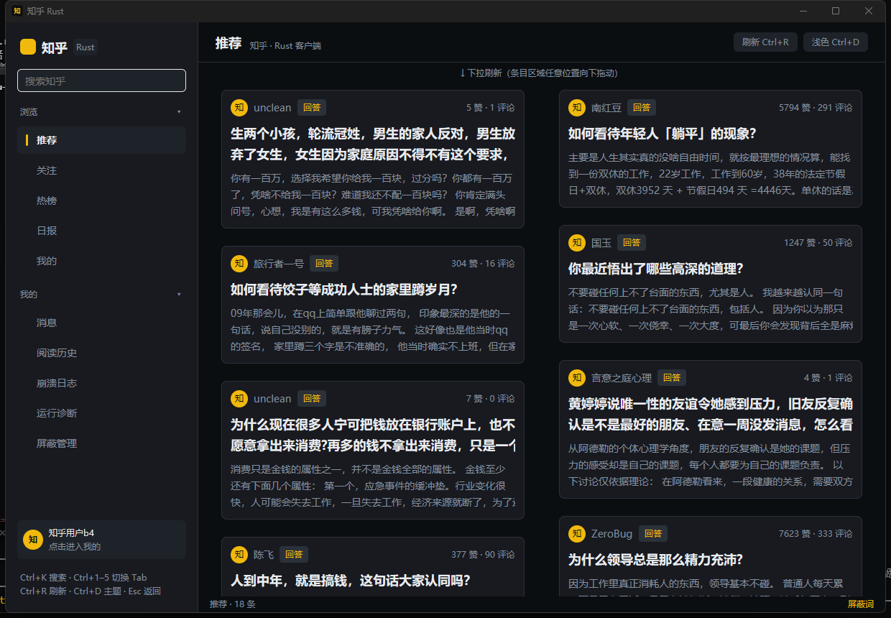 | 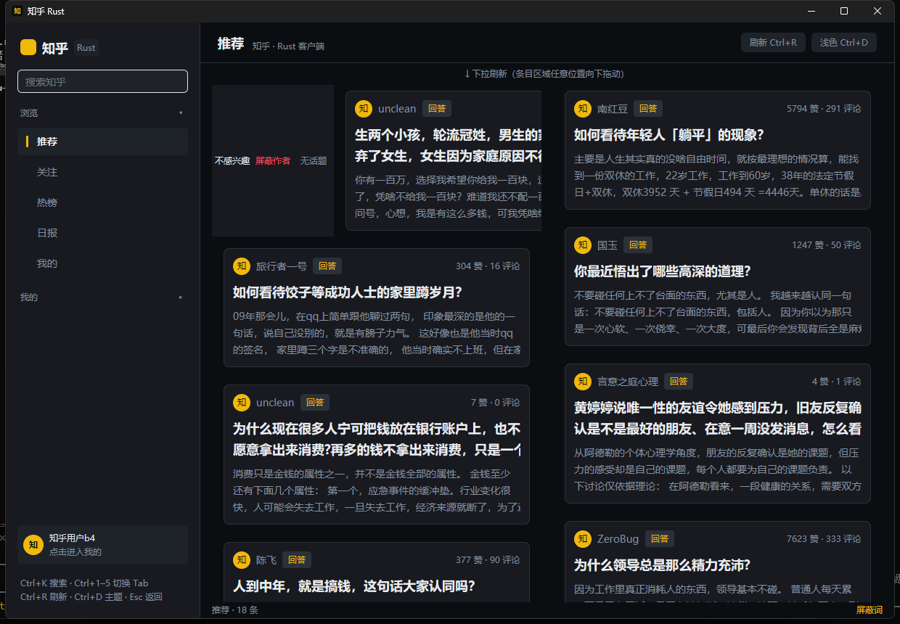 |

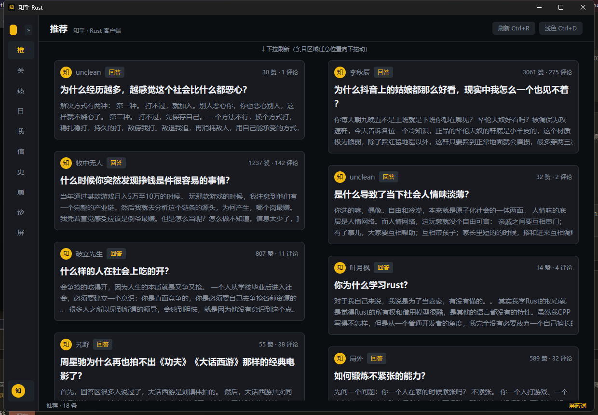

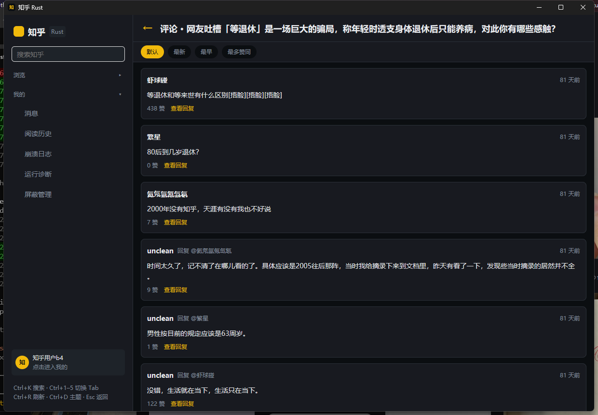

### 1.12 用户主页、评论互动、复制与日报内嵌

- **头像与用户主页**：
  - Feed 卡片/详情作者/评论者/通知用户显示头像（无头像时回退文字），
    点击头像或昵称进入用户主页。
  - 主页展示头像、昵称、简介、回答/文章/关注者/关注数、回答列表与分页，
    支持关注/取关（调用现有 follow 接口）。
- **回答/评论复制**：
  - 详情页顶部“复制”、评论与子评论“复制”按钮；
  - 复制为 Markdown（标题、粗体、列表、引用、代码、链接、公式、图片）；
  - 详情页聚焦时 `Ctrl+C` 复制整篇 Markdown。
- **评论互动**：
  - 根评论、子评论均支持“赞同/反对”（本地状态）与“喜欢”（知乎评论点赞接口）；
  - 0 回复时不显示“查看回复”；有回复显示条数；
  - 回复关系使用颜色标签：普通回复绿色、作者回复黄色、根评论 @ 关系蓝色。
- **问题页**：
  - 详情页“全部回答”或问题标题进入；
  - 问题标题、描述、回答/关注数、回答列表分页；
  - 回答排序：默认/最新/最多赞同。
  - 热榜词条会先解析为问题并进入问题页，找不到问题时回退搜索。
- **日报内嵌**：
  - 点击日报词条在应用内打开日报正文（`news-at.zhihu.com` API），
    不再跳转浏览器；复用富文本/图片/排版渲染。
- **其它修复**：
  - “我的”页改为 `size_full` + 子项 `flex_shrink_0`，恢复上下滚动；
  - 搜索结果卡片增加 `flex_shrink_0`，加载更多不再压扁；
  - 搜索筛选切换时清除旧的建议错误，避免“搜索失败”红字闪现。

| 用户主页 | 评论互动 |
| --- | --- |
| 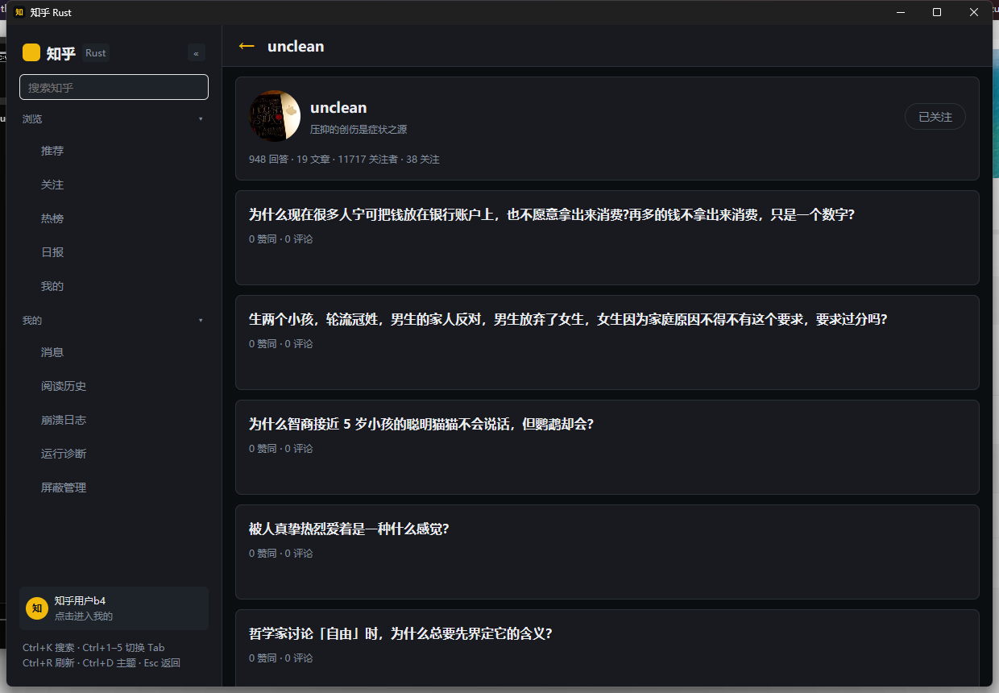 | 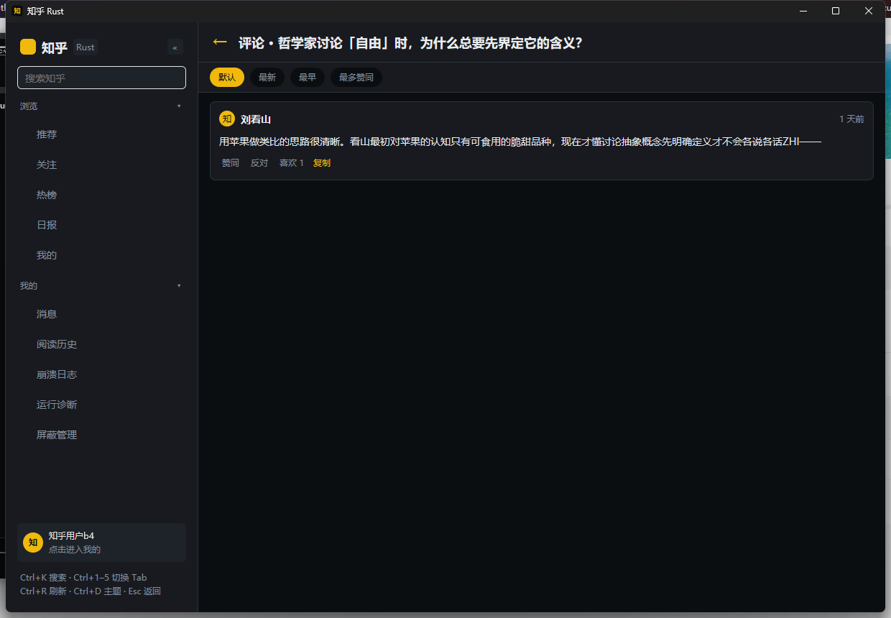 |

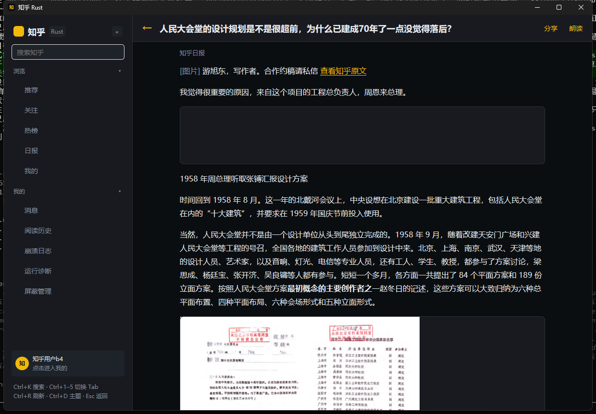

### 1.13 TTS 设置与同步朗读

- **引擎**：
  - Android：系统 `TextToSpeech`（音色/质量取决于系统 TTS 引擎与已安装语音）；
  - Windows：SAPI5 `System.Speech`（离线；本机常见 `Microsoft Huihui/Kangkang/Yaoyao Desktop`）；
  - macOS：`say`；Linux：`spd-say`。
- **设置页**（我的 → 朗读设置）：
  - 语速 0.5x–2.0x、音调 0.5–2.0、音量 0–100%；
  - 音色名称可选（Windows 例 `Microsoft Kangkang`；Android 例 `zh-cn-x-ccc-network`）；
  - 试听、恢复默认；全部持久化到 SQLite（`tts_rate/pitch/volume/voice`）。
- **同步朗读视图**：
  - 按段落/句子切分，当前句黄色高亮；
  - 自动滚动跟随当前句；
  - 点击任意句从该处开始；
  - 底部播放条：上一句 / 暂停 / 下一句 / 退出朗读 / 当前进度。
- **复制体验**：
  - 详情“选择”进入可拖选 TextView，松开左键自动复制选中内容并弹窗；
  - 详情/评论/子评论“复制”Markdown，成功弹窗“✓ 已复制…”；
  - 代码块“复制代码”、公式“复制公式”（LaTeX）；
  - 详情页 `Ctrl+C` 复制整篇 Markdown。
- **评论盖楼**：
  - 评论按回复关系阶梯缩进 + 左侧连接线，显示楼层号；
  - 评论/子评论头像回归显示；回复标签按层级/作者着色。

| TTS 设置 | 同步朗读 |
| --- | --- |
| 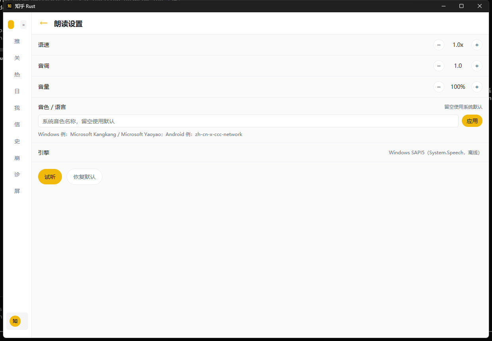 | 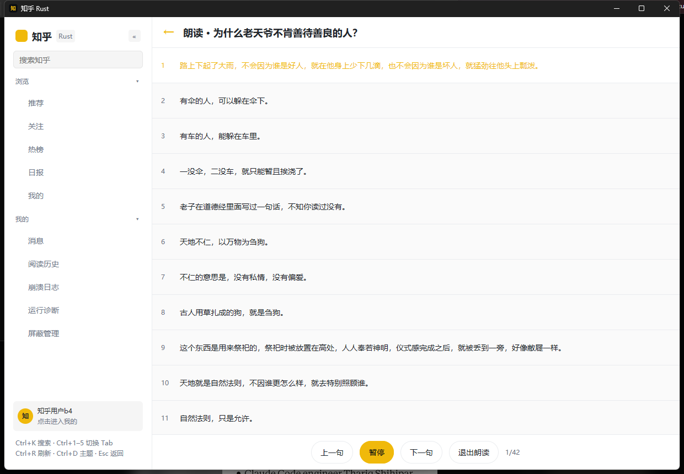 |

---

## 2. 验证

```bash
cargo nextest run --workspace
cargo clippy -p zhihu-api -p zhihu-core -p zhihu-store -p zhihu-types \
  -p zhihu-content -p zhihu-ui -p zhihu-desktop --all-targets -- -D warnings
cargo ndk -t arm64-v8a -P 26 -o android/app/src/main/jniLibs build -p zhihu-mobile
(cd android && ./gradlew assembleRelease --no-daemon)   # 或 assembleDebug
```

- 定向测试 **64 项通过**（UI/内容/推荐/存储/API/核心），含空白清洗、
  评论排序、反对/时间字段、分页、负向反馈、问题回答分页、Markdown 复制与 TTS 默认参数用例；
  按用户要求暂缓全量重跑与 APK 重建。
- clippy `-D warnings`（zhihu-ui / zhihu-core）通过。
- PC 包已在排版改动后重新构建；解压 zip 后启动验证通过（标题栏图标、双栏、
  排版预设、登录态推荐流、推荐排序开关）。
- PC 验收截图（`docs/m5-*.png`）：
  - 宽窗口推荐流、热榜、详情、评论、我的；
  - `Ctrl+1` / `Ctrl+5` 切 Tab、`Ctrl+D` 主题切换；
  - 回答 → 评论 → 返回正文恢复；
  - 运行诊断数据（数据目录、缓存体积、首屏/详情耗时）；
  - 崩溃日志列表/详情（清空与保留上限有单测）；
  - 窄窗口回退单栏。
- Android：
  - `cargo ndk ... build -p zhihu-mobile` 成功；
  - `llvm-strip` 后 `libzhihu_mobile.so` 约 83 MB；
  - `assembleRelease` 成功，产物 `android/app/build/outputs/apk/release/app-release.apk`
    约 85 MB（89,168,516 字节）；
  - 未配置 release keystore 时按设计回退 debug key，`apksigner` 校验通过；
  - `aapt2 dump badging`：`dev.zhihurs.app` / `1.0.0` / 自适应图标 `res/BW.xml`。
  - 注：以上 APK 为加入本地推荐前的构建；按用户要求本次未重建 APK。

| 桌面双栏 | 运行诊断 |
| --- | --- |
| 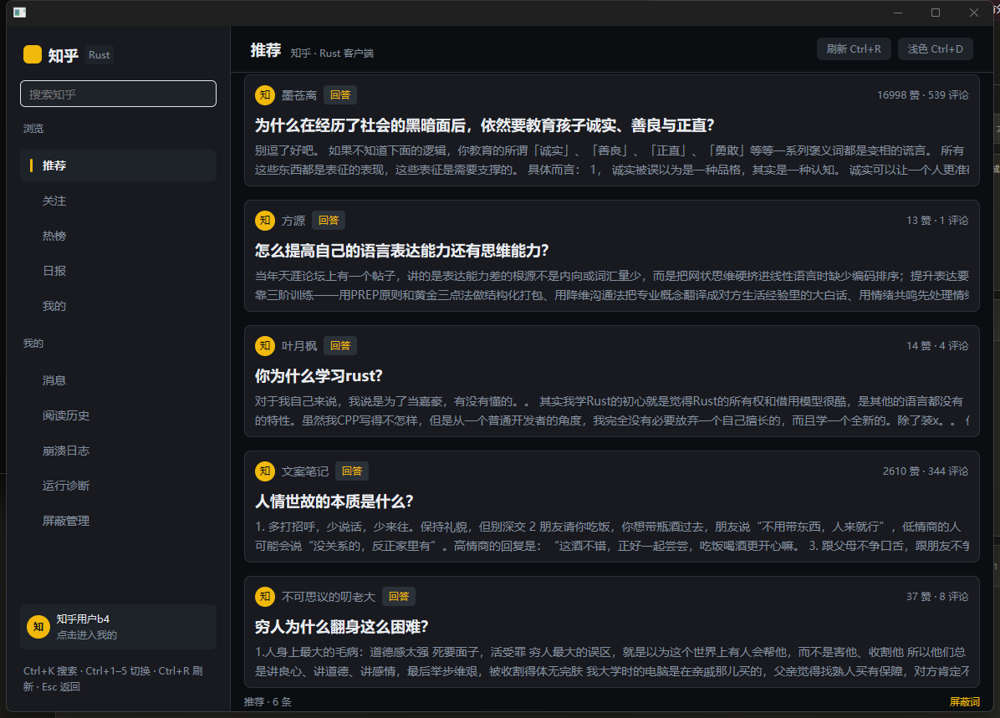 | 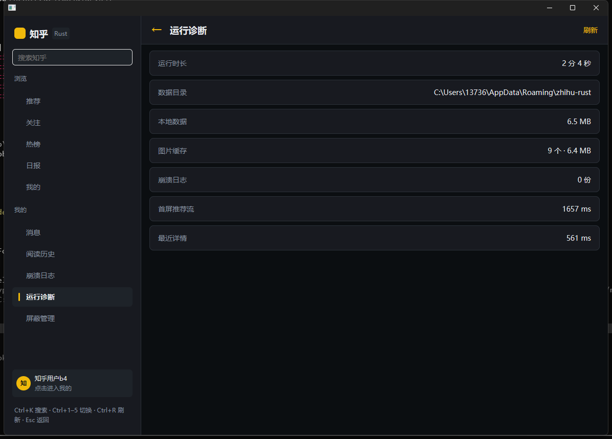 |

| 崩溃日志 | 评论返回后正文保留 |
| --- | --- |
| 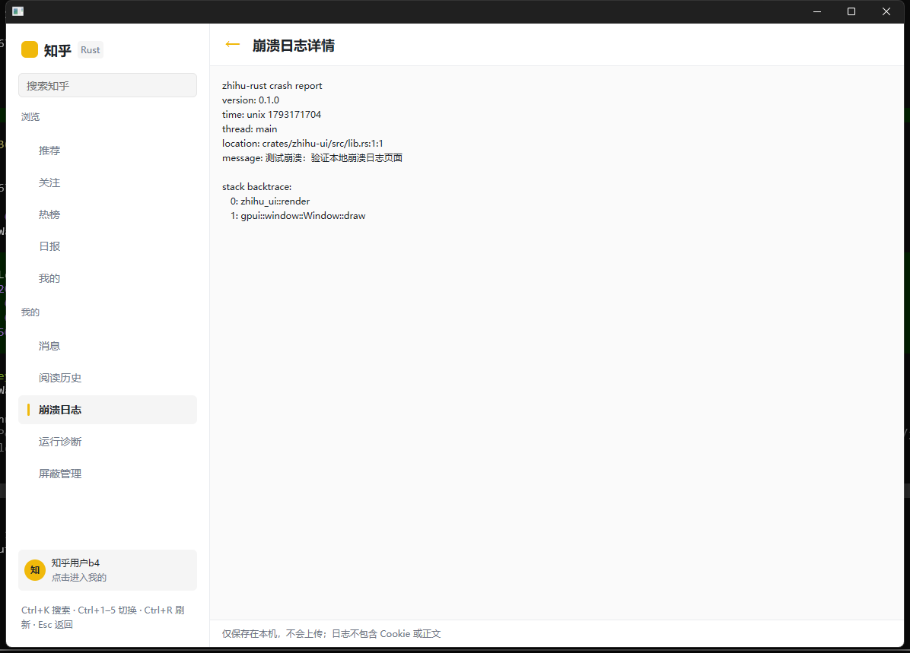 | 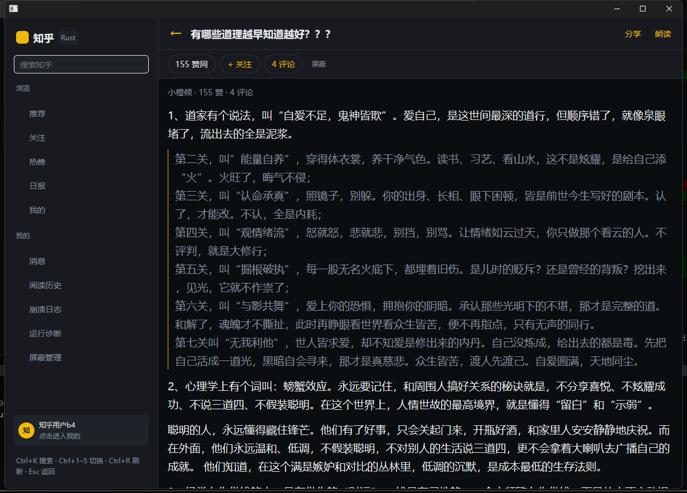 |

| 窄窗口回退单栏 | 应用图标 |
| --- | --- |
|  |  |


---

## 3. 剩余

| 任务 | 状态 |
| --- | --- |
| M4 真机门禁（视频/TTS/扫码/手机号/深链/评论回复/通知已读） | 待设备接入 |
| M5 真机回归（双栏不参与移动端） | 待设备接入 |
| 发布流水线实跑 | 需推送 tag 与配置 Secrets 后验证 |
| 商店截图/隐私页 | 图标已完成；截图与商店文案待发布前补齐 |
| 本地推荐 / 混合推荐 | 已实现可选模式（默认关闭、纯本地） |
| NLP 语义屏蔽（`ort`） | P2 评估完成，暂缓（包体/推理/误杀率） |
| AIGC 标记/投票 | 依赖服务端，暂不实现 |
| 行内公式图片化 | 当前 Unicode 投影；独立公式已 RaTeX |

---

## 4. 后续建议

1. 设备接入后先跑 M4 门禁清单，再补 M5 真机回归（桌面改动不影响移动端）。
2. 打 tag 前配置 `ZHIHU_KEYSTORE_*` Secrets，先用 `assembleRelease` 本地验证签名。
3. 本地推荐已落地最小版本；观察实际使用后再决定是否投入离线语料/向量方案。
